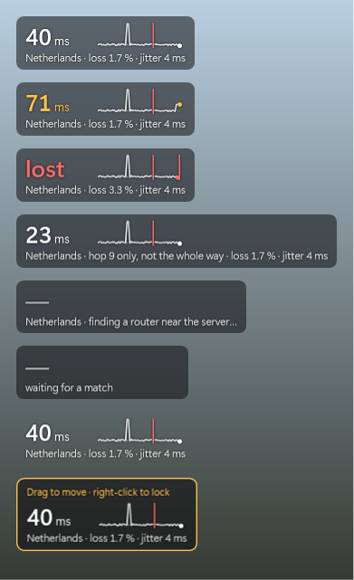

# MatchPing

**Your ping to the match server, on top of THE FINALS.** A small, open-source Windows app: a live ping number
with the last minute as a line, shown over the game during matches, out of the way the rest of the time.



- **The number**: the latest ping, once a second. White as usual, **amber** when it is 25 ms over the last minute's
  median (or a ping was lost in the last 10 s), **red** at 50 ms over it or 300 ms and up, and *lost* when no reply
  came back.
- **The line**: the last 60 seconds against their median (dashed); a red bar is a lost ping.
- **Under it**: the server's region (e.g. *Netherlands*), loss and jitter over the last minute.

It sits in the tray. **Ctrl+Alt+P** turns it on and off; right-click the tray icon to move it (drag, then
right-click to lock), resize it, change the box behind it, or start it with Windows.

*Not affiliated with or endorsed by Embark Studios. THE FINALS is a trademark of Embark Studios.*

<br clear="right">

## How it measures

Game servers don't answer pings, so MatchPing works it out in three steps — all of it plain Windows, nothing
installed, nothing touching the game:

1. **Which server.** Windows' own network event tracing (the *Microsoft-Windows-Kernel-Network* provider, the same
   data Resource Monitor shows) reports which address `Discovery.exe` sends its game traffic to. That address is the
   match server. This needs administrator rights, so MatchPing asks once (a UAC prompt) when it starts.
2. **Once a second.** One traceroute toward the server finds the last router on the way that answers pings —
   usually where Google's (or Amazon's) network begins — and MatchPing pings it every second. That is where your
   line's spikes and losses show up, as they happen.
3. **The rest of the way.** Google carries traffic from there to the server's region on its own backbone, which
   doesn't answer pings. So when the match starts, and every 5 minutes, MatchPing measures the round trip to the
   region itself and adds the difference to every ping:
   - Google Cloud: a few HTTPS requests to [GCPing](https://gcping.com)'s service in that region (an open-source
     Google Cloud project made for exactly this), timed to the first byte on a kept-alive connection;
   - AWS: a few TCP handshakes with that region's DynamoDB endpoint.

If the server itself answers pings, it is pinged directly. If nothing on the way answers (some networks drop them),
the region's round trip is measured every 5 seconds instead, and the overlay says so.

The result is close to the game's own round trip, but it is not the game's packets: routers answer pings with low
priority, so a ping can show a spike the game didn't have, and a VPN or "game routing" tool that only carries the
game's traffic takes a path the pings don't.

**See for yourself**: `MatchPing.exe --probe <server address>` writes what it would ping for that server and why
(the hops, which one answers, the region, the calibration).

## Is it safe with anti-cheat?

MatchPing never touches the game: no injection, no reading its memory, no driver, nothing sent to the game's
server. It finds the game by name in the process list and reads Windows' own network tracing, like Resource Monitor
or a firewall does; the overlay is an ordinary always-on-top window that clicks pass through. That is the kind of
tool anti-cheat systems leave alone — but only Embark can say what their anti-cheat accepts, so use it knowing that.

## Privacy and data

No accounts, no telemetry, nothing sent anywhere about you. What goes over the network:

| What | When | How much |
|---|---|---|
| Pings to one router on the way to the match server | once a second during matches | ~0.4 MB an hour |
| The region's round trip (GCPing / DynamoDB) | at the start of a match and every 5 minutes | a few KB |
| Google's and AWS's published address lists (which region a server is in) | once a week | ~3 MB |

Settings are in `%APPDATA%\MatchPing\settings.json`, the address lists in `%LOCALAPPDATA%\MatchPing`.

## Install

1. Download `MatchPing.exe` from [Releases](https://github.com/Almo7aya/matchping/releases) (or build it, below).
2. Run it. Windows asks for administrator rights (to see which server the game talks to); MatchPing goes to the tray.
3. Play. The overlay shows during matches.

Requirements: Windows 10 or 11, 64-bit (the .NET Framework 4.8 it uses is part of Windows). The overlay shows over
THE FINALS in *Windowed fullscreen* and in *Fullscreen* (DirectX 12 has no exclusive full screen).

## Build

```powershell
.\build.ps1        # dist\MatchPing.exe
```

The C# compiler comes from the [.NET SDK](https://dotnet.microsoft.com/download) and compiles against the .NET
Framework assemblies that ship with Windows: no NuGet packages, nothing downloaded. Every push is built on GitHub
Actions; tagged versions (`v*`) are published as releases with the .exe and its SHA-256.

| Argument | |
|---|---|
| `--demo` | made-up pings, to look at the overlay without the game |
| `--probe <ip> [file]` | where MatchPing would ping for that server, and why (written to a file) |
| `--etw-test <file> [--wait-match]` | checks Windows' network tracing (administrator); with `--wait-match`, waits for a match and writes which server the game used |
| `--snapshot <file.png>` | draws every overlay state into a picture |

## License

[MIT](LICENSE)
